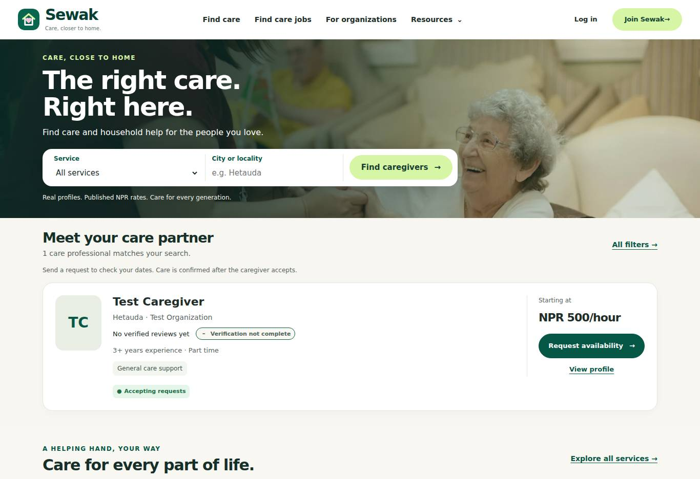
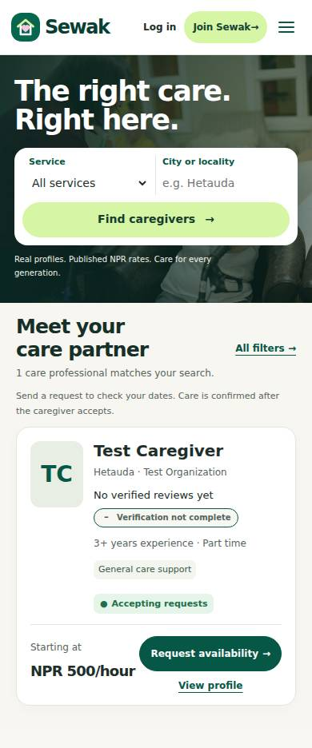

# Sewak care marketplace refresh

The homepage now brings real caregivers, published NPR rates and availability requests into the first screen. Search sits inside the video hero; the browse page starts with filters and results instead of a second promotional hero.

- Original illustrated categories and story links open the matching service results.
- Cards share a consistent portrait, experience, verification, price and request layout.
- Profiles keep public navigation and add a sticky request panel. Optional Nepal date/time preferences survive sign-in and prefill the existing booking form.
- Signup asks for account type first. Organization links preselect the organization flow, ahead of any stale saved role.
- Equivalent legacy service labels share one search choice while retaining provider assignments, active-service checks and organization boundaries.
- Public pages share typography, spacing, navigation and footer. Pricing/safety FAQs and genuine completed-booking reviews replace repeated promotional content.
- Existing licensed photos/video are retained; new service illustrations are original SVGs.

## Validation

115 frontend unit tests, 164 D1/Worker tests, type checking, lint and the production frontend build pass. 112 Chromium browser checks passed across regression batches: public/auth/role navigation, 320–1920px layouts, accessibility, video playback/pause/reduced motion, signup, discovery and a complete request → care session → verified review journey. The final phone check places the first caregiver's rate and request action within a 390 × 844 viewport.

The screenshots use isolated synthetic test accounts, not production caregiver records. No production data or Cloudflare deployment was changed.

## Previews

