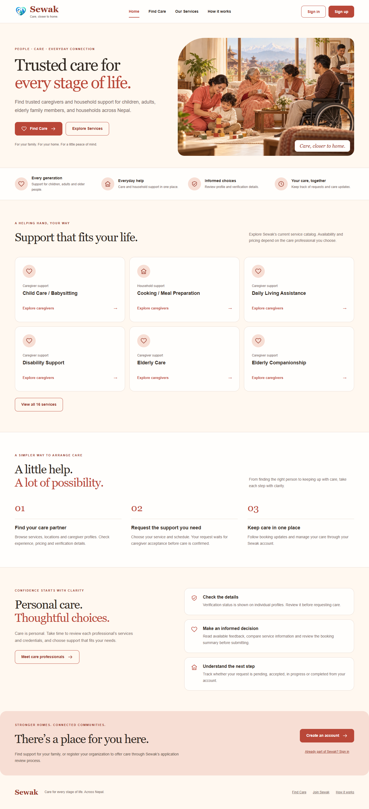

# Coral & Vanilla screenshot review

These are local Chrome captures with synthetic D1 accounts and records. They do not show production customers, financial results or availability. The baseline is `origin/main` at `387a45f`; after captures are from `feature/coral-vanilla-redesign`.

## Before and after

| Page / viewport | Before | After |
| --- | --- | --- |
| Sign in · 1440px | [Before](before/login-1440.png) | [After](after/login-1440.png) |
| Signup · 1440px | [Before](before/signup-1440.png) | [After](after/signup-1440.png) |
| Customer overview · 1440px | [Before](before/customer-1440-overview.png) | [After](after/customer-1440-overview.png) |
| Customer overview · 390px | [Before](before/customer-390-overview.png) | [After](after/customer-390-overview.png) |
| Caregiver overview · 1440px | [Before](before/caregiver-1440-overview.png) | [After](after/caregiver-1440-overview.png) |
| Admin overview · 1440px | [Before](before/admin-1440-overview.png) | [After](after/admin-1440-overview.png) |

The previous anonymous `/` redirected to discovery, so there is no equivalent homepage baseline. The new homepage uses the existing service catalog and contains no fabricated platform metrics.

## Additional desktop and mobile captures

| Page | Desktop | Mobile |
| --- | --- | --- |
| Homepage | [1366px](after/home-1366.png) | [375px](after/home-375.png) |
| Discovery | [1366px](after/browse-1366.png) | [375px](after/browse-375.png) |
| Organization | [1366px](after/organization-overview-1366.png) | [375px](after/organization-overview-375.png) |
| Booking request | [1440px](after/customer-1440-booking-request.png) | [390px](after/customer-390-booking-request.png) |
| Caregiver profile | [1440px](after/customer-1440-caregiver-details.png) | [390px](after/customer-390-caregiver-details.png) |
| Caregiver verification | [1440px](after/verification-caregiver-1440.png) | [390px](after/verification-caregiver-390.png) |
| Admin verification | [1440px](after/verification-admin-1440.png) | [390px](after/verification-admin-390.png) |

Full-page browser captures retain fixed navigation at the captured viewport's position. Verification captures also show the form exercised by the test. The after build preserves the deployed verification branch in addition to the redesign; the original `main` baseline predates that feature.

See the [implementation and validation report](../../CORAL-VANILLA-REDESIGN.md) for scope, test evidence, asset provenance and release boundaries.
